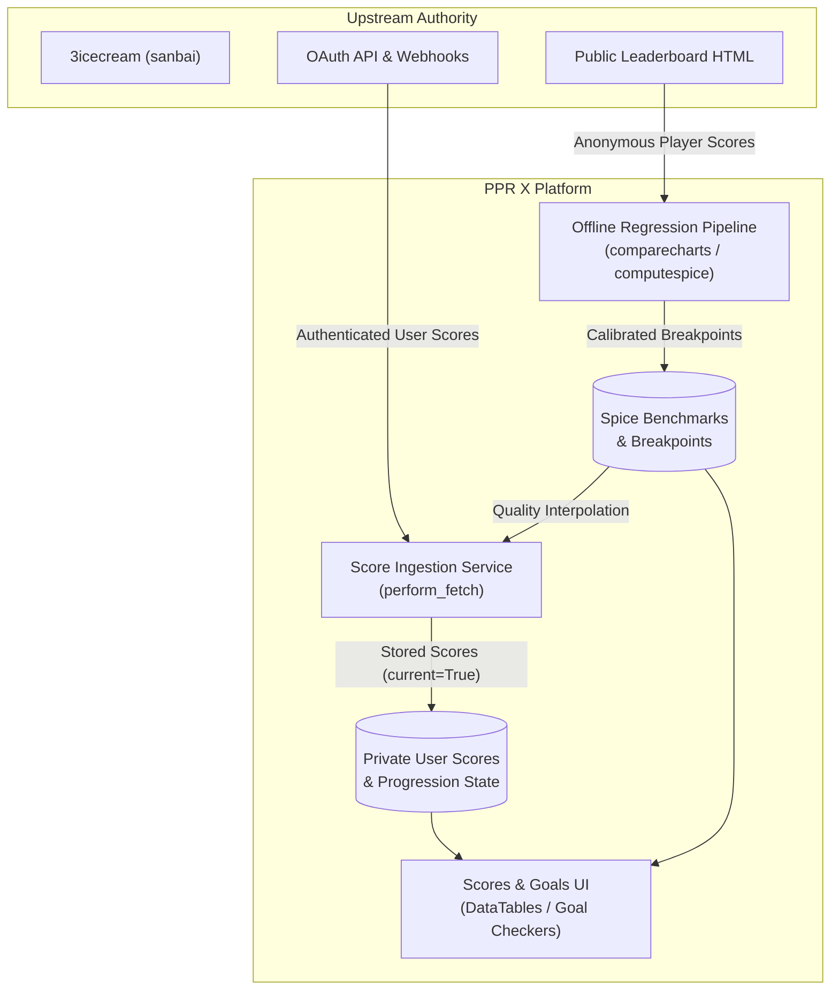

# PPR X: Vision & Scope

## 1. Executive Summary

**PPR X** is a specialized performance analytics, continuous difficulty calibration, and progression tracking platform for Dance Dance Revolution (DDR) players.

While official game systems rate songs using coarse, survival-oriented integer ratings, PPR X evaluates the continuous **Scoring Difficulty** of charts and provides dedicated players with transparent, normalized metrics to measure their personal growth, target high-yield improvements, and achieve milestone certifications (such as [LIFE4](https://life4ddr.com/)).

---

## 2. The Dual North Stars

PPR X is anchored by two complementary, co-equal pillars:

### Pillar 1: The Objective Scoring Difficulty Calibration Engine (`Spice`)
The calibration engine derives empirical, continuous difficulty ratings (**Spice**) for all active DDR charts, anchored to *MAX 300* Expert = 10.0.
- **Empirical Scoring Difficulty**: Unlike subjective community tier lists or heuristic step-density counters, Spice is derived mathematically via Orthogonal Distance Regression (ODR) and Centered Isotonic Regression (CIR) over anonymous public player score distributions.
- **Holistic Execution Reality**: Reading challenges, tempo fluctuations (SOF-LAN), stops, crossovers, and physical stamina demands are treated uniformly as real components of scoring difficulty. If players score lower on a chart in practice, its Spice calibrates higher.

### Pillar 2: The Actionable Progression Suite (`Quality` & Goal Discovery)
The progression suite translates raw game scores into standardized **Quality** metrics, giving users clear, linear visibility into their achievements and growth.
- **Linearized Milestone Discovery**: Because raw scores and coarse ratings hide non-linear difficulty jumps, Quality normalizes player achievement. The system highlights high-yield targets—identifying specific charts where a small, realistic improvement in Quality unlocks a personal goal, rank requirement, or barrier trial.
- **Diagnostic, Not Prescriptive**: PPR X serves as a precise diagnostic companion. It reveals where a player stands and where their opportunities lie, leaving practice regimens, setlist selections, and session design in the hands of the player or coach.

---

## 3. Core Domain Philosophy: Scoring vs. Passing Difficulty

A foundational insight of PPR X is that **Scoring Difficulty** and **Passing Difficulty** are distinct axes:

| Axis | System | Purpose | Characteristics |
| :--- | :--- | :--- | :--- |
| **Passing Difficulty** | Official Konami **Rating** (1–20) | Measures survival challenge (avoiding failing out). | Coarse integers; heavily weighted toward burst density, stamina cliffs, and fail hazards. |
| **Scoring Difficulty** | PPR X **Spice** (Continuous Decimal) | Measures the challenge of scoring precision (attaining 800k–1.0M). | Fine-grained decimal scale; sensitive to rhythm syncopation, reading pressure, SOF-LAN, and precision execution. |

PPR X does not exist to "correct" Konami's in-game ratings, because Konami's ratings are designed for passing. PPR X exists to solve the scoring problem for players whose primary objective is precision and milestone mastery.

---

## 4. Target Audience & Skill Horizon

- **Primary Audience: Uppers Players (Rating 13–19) & LIFE4 Grinders**:
  - The system is optimized for dedicated players working through the upper tiers of arcade DDR, where Konami's integer ratings break down (e.g. an "easy 16" vs. a "boss 16" representing significant skill difference).
  - Designed for players actively pursuing structured rank progressions, barrier trials, and competitive score optimization.
- **Secondary Audience: Dedicated Improvers (Any Skill Level)**:
  - Any player genuinely committed to measuring their scoring trajectory and finding high-yield practice targets across the game catalog.

---

## 5. Ecosystem & Data Architecture

### Upstream Authority & Ingestion
- **Downstream of 3icecream**: PPR X treats 3icecream as its upstream source of truth for chart definitions (`songdata.js`) and authenticated user scores (`/dev/api/v1/get_scores`).
- **Separation of Calibration vs. User Data**:
  - **Spice calibration** relies entirely on anonymous, publicly scraped leaderboard data from 3icecream (Player profiles).
  - **Progression tracking** relies on authenticated OAuth connections for individual registered users (User profiles).
- **Official API Posture**: Should Konami ever release an official, modern API for e-amusement score data, transitioning to it would be a top architectural priority. Direct scraping of Konami's proprietary e-amusement website remains out of scope due to operational and anti-bot fragility.

### Privacy by Default
- Registered **User** score profiles default to private personal dashboards. Players retain control over whether their profile is public, friends-only, or unlisted, while population-level Spice calibrations remain transparent and open to all.

---

## 6. Catalog Lifecycle & The "Can't-Hurt-Can-Help" Invariant

PPR X balances the realities of physical arcade hardware with long-term player score preservation:

- **Active Arcade Reality**: The score browser strictly respects real-world arcade playability, filtering charts dynamically by **Cabinet** (White cab vs. Gold cab vs. Gold-exclusive), **Region** (North America, Japan, Europe), and active in-game **Unlocks**.
- **Historical Score Retention**: When songs are culled or licenses expire in newer arcade versions, user scores are permanently retained in the database.
- **The "Can't-Hurt-Can-Help" Rule (LIFE4)**: In accordance with LIFE4 guidelines, scores on culled historical charts or locked/unlocked charts can satisfy quantity-based rank requirements, but are never required for comprehensive criteria.

---

## 7. Explicit Anti-Goals & Out-of-Scope Boundaries

To maintain software integrity and operational focus, the following are strictly **Out of Scope**:

1. **Direct Konami Scraping or Manual Score Submission**: No fragile web scraping of e-amusement and no self-reported "honor system" manual score entry. All scores must originate from verified 3icecream synchronization.
2. **Game Simulation & Stepchart Rendering**: PPR X is an analytical companion, not a game client or stepchart viewer. Simulators like StepMania and viewers like Zenius-i-vanisher or ArrowVortex fulfill this role.
3. **Social Media & Community Feeds**: No activity feeds, direct messaging, user forums, or social networking features. Discussion belongs in dedicated community spaces (Discord, Reddit).
4. **Prescriptive Coaching & Session Planners**: No automated daily practice setlists, algorithmic warm-up generators, or rigid session prescriptions.
5. **In-Repo Multi-Game Generalization**: PPR X's domain model is unapologetically DDR-native (cabinets, regions, LIFE4, 3icecream). The codebase will not introduce abstract multi-game layers or generic game engines. (The mathematical calibration pipeline remains modular so it may be cleanly forked for other games in a separate repository if desired).
6. **Proprietary or Black-Box Algorithms**: Calibration methods (ODR, CIR, logarithmic score normalization) and Quality formulas must remain fully transparent, documented, and reproducible.

---

## 8. Aspirational Longshots (Future Research)

These represent exploratory, long-term ambitions that do not constrain current architectural milestones:

- **Difficulty Decomposition via Tech Notation**: Exploring methods to attach objective technique tags to charts (e.g. crossovers, footspeed, stamina, drills, reading gimmicks) and work backward from realized scoring difficulty to attribute a chart's challenge to specific physical/technical drivers.
- **Technique-Specific Player Skill Profiling**: Utilizing difficulty decomposition to provide players with multi-dimensional skill ratings across specific technique areas rather than a single aggregate score.

---

## 9. Project Governance

PPR X is a curated personal project developed and directed by **`rrwoods`**. The calibration methodology and algorithms are shared openly with the rhythm game community, and issue tracking is managed via GitHub, while architectural direction remains closely curated to protect the platform's core identity.
